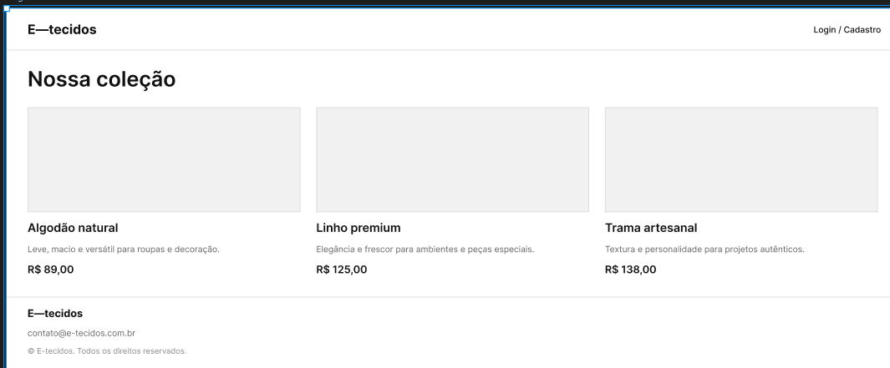
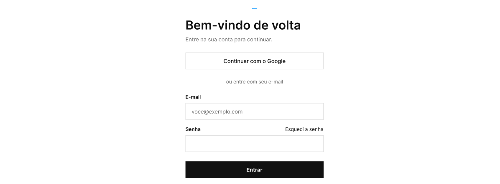
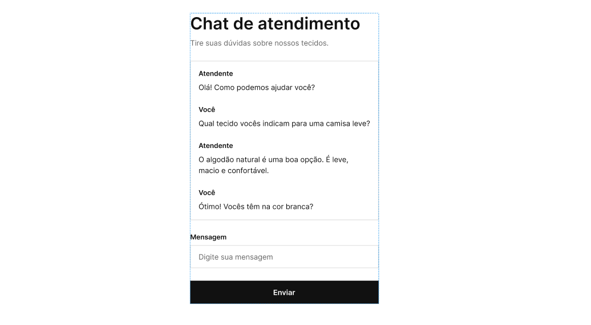
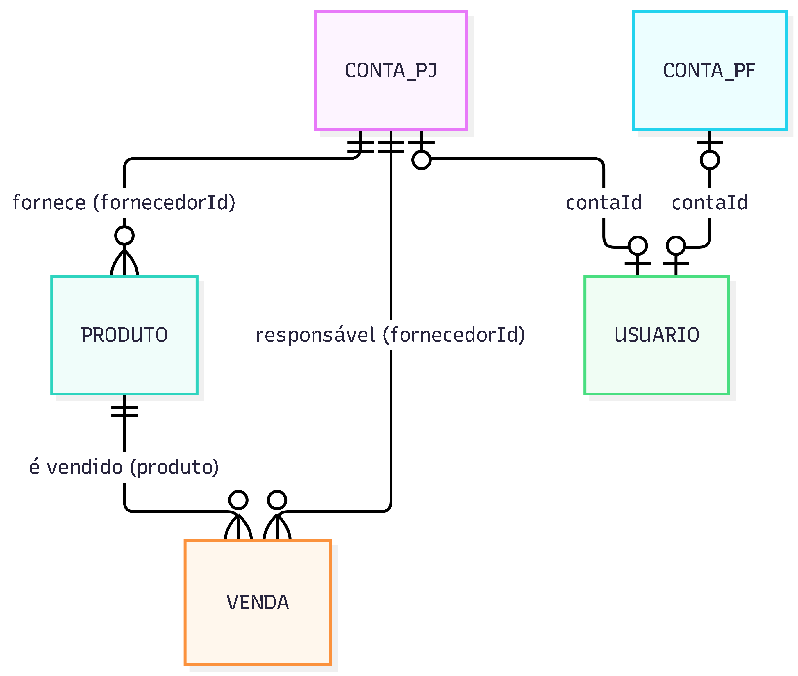

# E-tecidos

Loja demonstrativa de tecidos feita com **React**, **Vite**, **React Router**, **Bootstrap**, **React Hook Form**, **Zod**, **TanStack Query**, **Express** e **MongoDB**. Inclui catálogo, carrinho, cadastro, login com JWT e áreas administrativas.

## Protótipos

### Loja



### Login



### Chat


## Funcionalidades

- **Loja**: catálogo de tecidos com cards de produto e detalhes expansíveis.
- **Carrinho**: adicionar, alterar quantidade, remover e limpar itens (exige login).
- **Login e cadastro**, com perfis de acesso por permissão.
- **Formulários** validados com React Hook Form e Zod; consultas de dados gerenciadas pelo TanStack Query.
- **Painel administrativo**: histórico de vendas, gestão de produtos e gestão de contas de pessoa física e pessoa jurídica.
- **Cabeçalho e rodapé** compartilhados, com layout responsivo (desktop e mobile).

## Rotas

| Rota | Acesso | Descrição |
| --- | --- | --- |
| `/` | Público | Loja |
| `/login` | Público | Entrar |
| `/cadastro` | Público | Criar conta |
| `/carrinho` | Usuário logado | Carrinho |
| `/admin` | `vendas:read` | Painel de vendas |
| `/admin/produtos` | `produtos:write` | Gestão de produtos |
| `/admin/contas/pessoa-fisica` | `contas:manage` | Contas de pessoa física |
| `/admin/contas/pessoa-juridica` | `contas:manage` | Contas de pessoa jurídica |

Após o login, o administrador e o fornecedor pessoa jurídica são direcionados ao painel de vendas (`/admin`). Os dados do fornecedor são limitados à loja vinculada à sua conta. O cliente pessoa física é direcionado à vitrine (`/`).

## Requisitos

- Node.js compatível com a versão do Vite instalada
- npm
- MongoDB (local ou serviço gerenciado)

## Instalação e execução

```bash
npm install
npm --prefix backend install
```

### Configurar o MongoDB para testar

O banco MongoDB e o login da loja são contas diferentes: a URI usa um usuário de banco criado no MongoDB Atlas; depois, quem testa entra no site com uma das contas de demonstração abaixo.

1. No [MongoDB Atlas](https://www.mongodb.com/cloud/atlas), crie ou selecione um cluster. Em **Database Access**, crie um usuário de banco com permissão `readWrite` para o banco `e_tecidos`. Em **Network Access**, autorize o IP da máquina que executará a aplicação.
2. No Atlas, escolha **Connect > Drivers**, copie a URI do cluster e substitua `<password>` pela senha desse usuário. Se a senha tiver caracteres especiais, codifique-os para URL. Use o nome do banco `e_tecidos` na URI, por exemplo:

   ```text
   mongodb+srv://<usuario-do-banco>:<senha-codificada>@<cluster>.mongodb.net/e_tecidos?retryWrites=true&w=majority
   ```

3. Crie `backend/.env` a partir de [`backend/.env.example`](backend/.env.example) e configure pelo menos:

   ```dotenv
   PORT=3001
   MONGODB_URI="mongodb+srv://<usuario-do-banco>:<senha-codificada>@<cluster>.mongodb.net/e_tecidos?retryWrites=true&w=majority"
   JWT_SECRET="<segredo-aleatorio-com-pelo-menos-32-caracteres>"
   CORS_ORIGIN=http://localhost:5173
   ```

   Gere o segredo JWT com `node -e "console.log(require('node:crypto').randomBytes(48).toString('base64url'))"`. O arquivo `.env` contém credenciais: não o envie, publique ou faça commit. O Atlas configura o cluster como replica set, requisito do Prisma para operações transacionais.
4. Instale as dependências e crie as coleções/índices e os dados iniciais:

```bash
npm install
npm --prefix backend install
npm run db:push
npm run db:seed
```

Rode `db:push` e `db:seed` apenas para preparar o banco de teste. O seed carrega os dados de demonstração sem substituir registros que já existam. Inicie API e frontend em terminais separados:

```bash
npm run server
```

```bash
npm run dev
```

Abra `http://localhost:5173`. O Vite encaminha as chamadas `/api` ao backend Express na porta definida por `PORT` (3001 no exemplo acima; 3000 se não estiver definida).

## Executar com Docker

Com Docker Engine e Docker Compose instalados, crie o arquivo `.env` na raiz a partir de `.env.example` e substitua `JWT_SECRET` por um segredo aleatório com pelo menos 32 caracteres. Inicie os serviços:

```bash
docker compose up --build
```

A aplicação ficará disponível em `http://localhost:8080`. O Compose inicia o frontend, a API e um MongoDB local configurado como replica set de nó único, necessário para as transações do Prisma. Os dados do banco ficam no volume `mongo-data`. Para parar os serviços, use `docker compose down`; para também remover o banco local, use `docker compose down --volumes`.

## Usuários de demonstração

| Perfil | E-mail | Senha | Acesso |
| --- | --- | --- | --- |
| Administrador | `admin@e-tecidos.com.br` | `Admin@123` | Vendas, produtos e contas |
| Fornecedor PJ | `compras@casaaurora.exemplo.com` | `Fornecedor@123` | Consulta de vendas e CRUD dos próprios produtos |
| Cliente PF | `marina.albuquerque@exemplo.com` | `Cliente@123` | Loja e carrinho, sem painel administrativo |

A área de contas é exclusiva do administrador. O fornecedor pode consultar vendas, mas não criá-las, editá-las ou excluí-las.

## Modelo de dados

### Entidades

Cinco coleções ficam no MongoDB e duas entidades ficam só no navegador.

| Entidade | Coleção / armazenamento | Id | Descrição |
| --- | --- | --- | --- |
| **Produto** | `produtos` | slug (`algodao`) | Tecido do catálogo, com preço por metro e fornecedor |
| **Venda** | `vendas` | `V-1048` | Venda de um produto, exibida no histórico do painel |
| **Conta PF** | `contasPessoaFisica` | `PF-001` | Conta de cliente pessoa física |
| **Conta PJ** | `contasPessoaJuridica` | `PJ-001` | Conta de empresa; também é o fornecedor |
| **Usuário** | `usuarios` | `USR-001` | Credencial de login com tipo de perfil e permissões |
| **Carrinho** | `localStorage` | - | Itens do carrinho, um só por navegador |
| **Sessão** | `sessionStorage` | - | Usuário autenticado, dura enquanto a aba estiver aberta |

### Campos

**Produto**

| Campo | Tipo | Observação |
| --- | --- | --- |
| `id` | texto | Identificador da API (slug gerado a partir do título); `_id` interno é criado pelo MongoDB |
| `titulo` | texto | |
| `resumo` | texto | Texto curto do card |
| `detalhe` | texto | Texto do "Saiba mais" |
| `imagem` | texto (URL) | |
| `alt` | texto | Texto alternativo da imagem |
| `preco` | número | Preço por metro |
| `custoPorMetro` | número | Estimativa fictícia, usada no lucro bruto do painel |
| `fornecedorId` | texto | Referência a `Conta PJ.id` |

**Venda**

| Campo | Tipo | Observação |
| --- | --- | --- |
| `id` | texto | Identificador da API (`V-` + número); `_id` interno é criado pelo MongoDB |
| `data` | data (AAAA-MM-DD) | |
| `cliente` | texto | Nome livre, não é referência a uma conta |
| `tipo` | texto | `fisica` ou `juridica` |
| `produto` | texto | Referência a `Produto.id` |
| `metros` | número | |
| `status` | texto | `Pago`, `Pendente` ou `Cancelado` |
| `pagamento` | texto | Ex.: `Crédito 3x` |
| `valor` | número | |
| `fornecedorId` | texto | Referência a `Conta PJ.id` |

**Conta PF**

| Campo | Tipo | Observação |
| --- | --- | --- |
| `id` | texto | Identificador da API (`PF-` + número); `_id` interno é criado pelo MongoDB |
| `nome` | texto | |
| `cpf` | texto | |
| `email` | texto | |
| `nascimento` | data (AAAA-MM-DD) | |
| `endereco` | texto | |
| `status` | texto | `ativa` ou `suspensa` |
| `criadoEm` | data (AAAA-MM-DD) | |

**Conta PJ**

| Campo | Tipo | Observação |
| --- | --- | --- |
| `id` | texto | Identificador da API (`PJ-` + número); `_id` interno é criado pelo MongoDB |
| `razaoSocial` | texto | |
| `cnpj` | texto | |
| `email` | texto | |
| `localizacao` | texto | |
| `descricao` | texto | |
| `status` | texto | `ativa` ou `suspensa` |
| `criadoEm` | data (AAAA-MM-DD) | |

**Usuário**

| Campo | Tipo | Observação |
| --- | --- | --- |
| `id` | texto | Identificador da API (`USR-` + número); `_id` interno é criado pelo MongoDB |
| `nome` | texto | |
| `email` | texto | Usado no login |
| `passwordHash` | texto | Hash scrypt; nunca enviado pela API |
| `tipo` | texto | `admin`, `juridica` ou `fisica` |
| `contaId` | texto | Referência a `Conta PF.id` ou `Conta PJ.id`; nulo no administrador |
| `permissoes` | lista de textos | `vendas:read`, `vendas:write`, `produtos:write`, `contas:manage` |

**Carrinho** (`localStorage`, chave `e-tecidos-carrinho`): lista de itens com `id` (id do produto) e `quantidade`.

**Sessão** (`sessionStorage`): JWT e dados públicos (`id`, `nome`, `email`, `tipo`, `contaId`, `permissoes`). A senha e seu hash não são guardados no navegador.

### Relacionamentos



- Um fornecedor é uma conta de pessoa jurídica. `fornecedorId`, em Produto e em Venda, aponta para `Conta PJ.id`.
- `Venda.produto` aponta para `Produto.id`.
- `Usuario.contaId` liga o login à conta do cliente (`PF-...`) ou do fornecedor (`PJ-...`). No administrador é nulo.
- `permissoes` não é chave estrangeira: define quais rotas e ações o usuário acessa.

### Matriz CRUD

C = criar, R = ler, U = atualizar (inclui suspender e reativar contas), D = excluir.
**X** = permitido · **P** = permitido só nos registros do próprio fornecedor (filtro por `fornecedorId`) · **-** = sem acesso pela interface.

| Entidade | Visitante | Cliente PF | Fornecedor PJ | Administrador |
| --- | :---: | :---: | :---: | :---: |
| | C R U D | C R U D | C R U D | C R U D |
| **Produto** | - X - - | - X - - | P X P P | X X X X |
| **Venda** | - - - - | - - - - | - P - - | X X X X |
| **Conta PF** | - - - - | - - - - | - - - - | X X X X |
| **Conta PJ** | - - - - | - - - - | - - - - | X X X X |
| **Usuário** | - X - - | - X - - | - X - - | - X - - |
| **Carrinho** | - - - - | X X X X | X X X X | X X X X |
| **Sessão** | X - - - | - X - X | - X - X | - X - X |

Observações:

- **Vendas:** ler exige `vendas:read` e criar, editar e excluir exigem `vendas:write`. Nenhuma tela de compra grava vendas; elas só nascem no painel do administrador.
- **Contas:** o cadastro público cria uma conta PF ou PJ e suas credenciais; dados de cartão não são coletados nem armazenados.
- **Usuários:** credenciais não são expostas por endpoints de coleção; login verifica o hash no servidor e emite JWT.
- **Carrinho e sessão:** o carrinho exige login para adicionar e ver. A sessão é criada no login e apagada ao sair.

## API

Coleções MongoDB: `produtos`, `vendas`, `contasPessoaFisica`, `contasPessoaJuridica` e `usuarios`.

```text
POST   /api/auth/login
POST   /api/auth/cadastrar
GET    /api/health
GET    /api/produtos                         público
GET    /api/vendas                           vendas:read
GET    /api/contasPessoaFisica               contas:manage
GET    /api/contasPessoaJuridica             contas:manage
POST   /api/{produtos,vendas,contas...}      permissão de escrita correspondente
PUT/PATCH/DELETE /api/{coleção}/:id          permissão de escrita correspondente
```

Rotas protegidas exigem `Authorization: Bearer <JWT>`. O backend valida permissões e limita leitura e escrita de produtos e vendas do fornecedor ao `fornecedorId` da conta autenticada. O cliente HTTP está em `frontendd/src/utils/api.js`.

## Dados e persistência

O schema Prisma fica em `backend/prisma/schema.prisma`. Execute `npm run db:push` para sincronizar os índices e coleções; `npm run db:seed` importa os arquivos de `frontendd/src/data` e converte as senhas demonstrativas em hashes. O seed não sobrescreve registros existentes.

O conector MongoDB do Prisma requer uma instância configurada como replica set. Em produção/local, configure `MONGODB_URI` para esse replica set antes de executar os comandos.

## Estrutura

```text
backend/src/
  config/         MongoDB e logger
  controllers/    Login, cadastro e CRUD
  middleware/     JWT, permissões e erros
  models/         Schemas Mongoose
  routers/        Rotas REST
  scripts/        Importação inicial de dados
frontendd/src/
  auth/           Contexto, sessão, permissões e guardas de rota
  components/     Header, Bottom (rodapé), ProdutoCard, Carrinho, AdminLayout
  data/           Sementes e configuração em JSON
  hooks/          Estado e operações das telas
  pages/          Loja, login, cadastro e páginas administrativas
  styles/         Tema visual e estilos por página
  utils/          Cliente da API e funções auxiliares
```

## Comandos

```bash
npm run dev       # inicia o Vite
npm run server    # inicia a API Express
npm run db:push   # sincroniza o schema Prisma com o MongoDB
npm run db:seed   # importa dados iniciais no MongoDB
npm run build     # cria o bundle de produção
npm run preview   # serve o bundle de produção
npm run lint      # executa o ESLint
```

## Segurança

As credenciais listadas são apenas para demonstração local. Use um segredo JWT forte e credenciais próprias em ambientes reais. A API protege rotas por JWT/permissão, armazena hash scrypt das senhas e não recebe dados de cartão.


## Pendências

Funcionalidades ainda não implementadas. Ambas dependem do login e dos perfis já existentes.

### Avaliação de produtos

Permite que clientes avaliem os tecidos que compraram e que a loja exiba a opinião de quem já usou.

**Comportamento planejado**

- O cliente PF dá uma nota de 1 a 5 e, se quiser, escreve um comentário sobre o produto.
- Só pode avaliar quem tem uma venda com status `Pago` daquele produto, e apenas uma avaliação por venda.
- O card e os detalhes do produto mostram a nota média e a quantidade de avaliações.
- O fornecedor vê as avaliações dos próprios produtos (filtro por `fornecedorId`), sem poder editá-las.
- O administrador pode ocultar ou excluir avaliações inadequadas.

**Novas rotas**

| Rota | Acesso | Descrição |
| --- | --- | --- |
| `/produto/:id/avaliacoes` | Público | Lista de avaliações do produto |
| `/admin/avaliacoes` | `avaliacoes:moderate` | Moderação de avaliações |

**Nova entidade: Avaliação** (coleção `avaliacoes`)

| Campo | Tipo | Observação |
| --- | --- | --- |
| `id` | texto | Chave primária (`AV-` + número) |
| `produtoId` | texto | Referência a `Produto.id` |
| `vendaId` | texto | Referência a `Venda.id` |
| `contaId` | texto | Referência a `Conta PF.id` |
| `nota` | número | De 1 a 5 |
| `comentario` | texto | Opcional |
| `data` | data (AAAA-MM-DD) | |
| `status` | texto | `visivel` ou `oculta` |

**CRUD previsto**

| Entidade | Visitante | Cliente PF | Fornecedor PJ | Administrador |
| --- | :---: | :---: | :---: | :---: |
| | C R U D | C R U D | C R U D | C R U D |
| **Avaliação** | - X - - | X X X X | - P - - | - X X X |

Cliente PF: edita e exclui apenas as próprias avaliações. Administrador: atualiza para ocultar ou reexibir.

**Pré-requisito:** hoje nenhuma tela de compra grava vendas, pois elas só nascem no painel do administrador. Para a avaliação fazer sentido, é preciso um fluxo de finalização de compra que gere a venda a partir do carrinho.

### Chat de comunicação

Canal de conversa dentro da loja, para dúvidas antes e depois da compra.

**Comportamento planejado**

- O cliente PF inicia uma conversa com o fornecedor a partir da página do produto (por exemplo, para perguntar sobre cor, metragem ou prazo).
- Cada conversa fica ligada a um produto e a um fornecedor.
- O fornecedor responde pelas conversas dos próprios produtos.
- O administrador pode acompanhar qualquer conversa e também abrir uma conversa de suporte com um cliente ou fornecedor.
- Cada conversa mostra as mensagens em ordem cronológica e indica quais ainda não foram lidas.
- Na primeira versão, as mensagens são atualizadas por consulta periódica à API (polling), já que o JSON Server não oferece tempo real.

**Novas rotas**

| Rota | Acesso | Descrição |
| --- | --- | --- |
| `/chat` | Usuário logado | Lista de conversas |
| `/chat/:conversaId` | Participante ou administrador | Mensagens de uma conversa |

**Novas entidades**

**Conversa** (coleção `conversas`)

| Campo | Tipo | Observação |
| --- | --- | --- |
| `id` | texto | Chave primária (`CH-` + número) |
| `produtoId` | texto | Referência a `Produto.id`; nulo em conversa de suporte |
| `clienteId` | texto | Referência a `Conta PF.id` |
| `fornecedorId` | texto | Referência a `Conta PJ.id` |
| `status` | texto | `aberta` ou `encerrada` |
| `criadaEm` | data (AAAA-MM-DD) | |

**Mensagem** (coleção `mensagens`)

| Campo | Tipo | Observação |
| --- | --- | --- |
| `id` | texto | Chave primária (`MSG-` + número) |
| `conversaId` | texto | Referência a `Conversa.id` |
| `autorId` | texto | Referência a `Usuario.id` |
| `texto` | texto | |
| `enviadaEm` | data e hora | Formato ISO 8601 |
| `lida` | booleano | |

**CRUD previsto**

| Entidade | Visitante | Cliente PF | Fornecedor PJ | Administrador |
| --- | :---: | :---: | :---: | :---: |
| | C R U D | C R U D | C R U D | C R U D |
| **Conversa** | - - - - | X P - - | - P P - | X X X - |
| **Mensagem** | - - - - | X P - - | X P - - | X X - - |

P = apenas nas conversas das quais o usuário participa. Atualizar a conversa significa encerrá-la ou reabri-la; atualizar a mensagem significa marcá-la como lida.

**Cuidados**

- A API ainda não aplica autorização. Sem isso, qualquer pessoa que acesse o JSON Server consegue ler todas as conversas. Antes de usar o chat com dados reais, a leitura e a escrita de mensagens precisam ser protegidas no servidor.
- Considerar limite de tamanho da mensagem e bloqueio de envio em conversas encerradas.